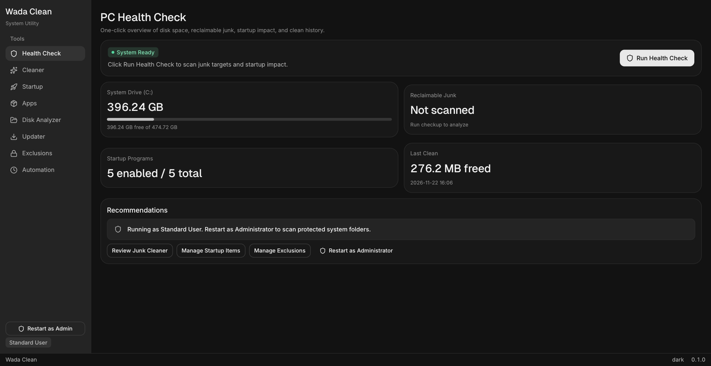
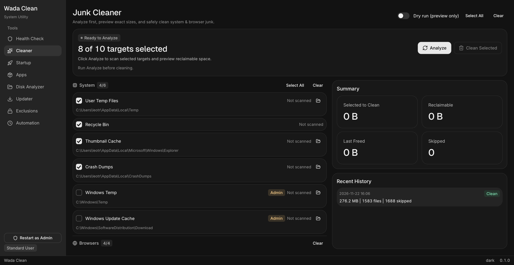
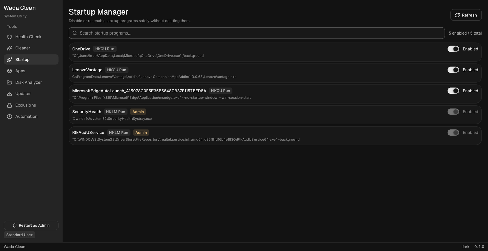
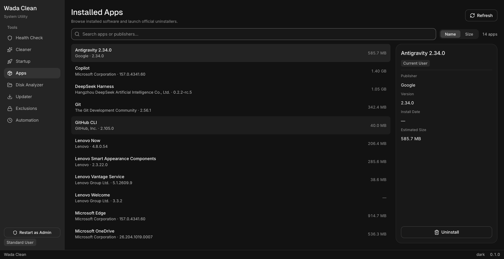
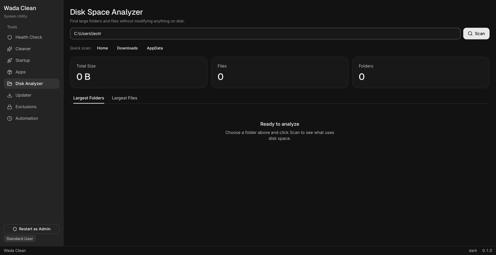
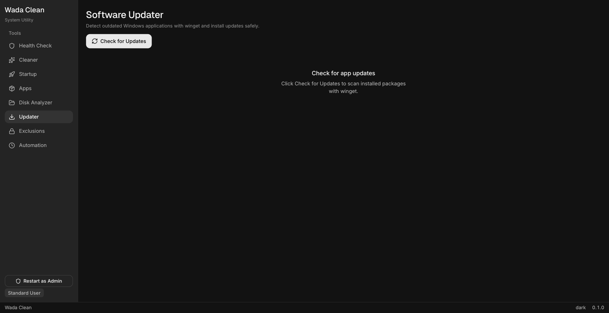
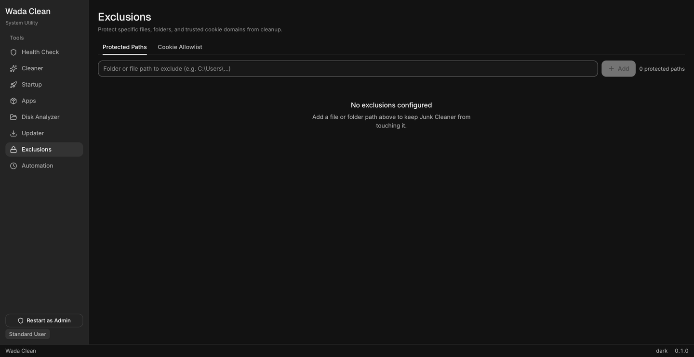
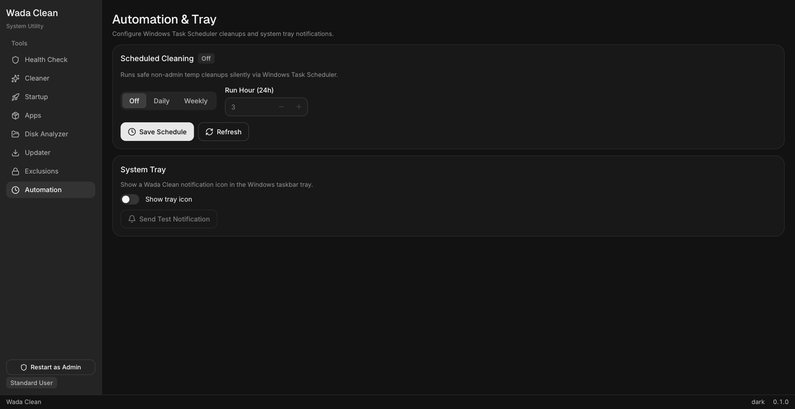
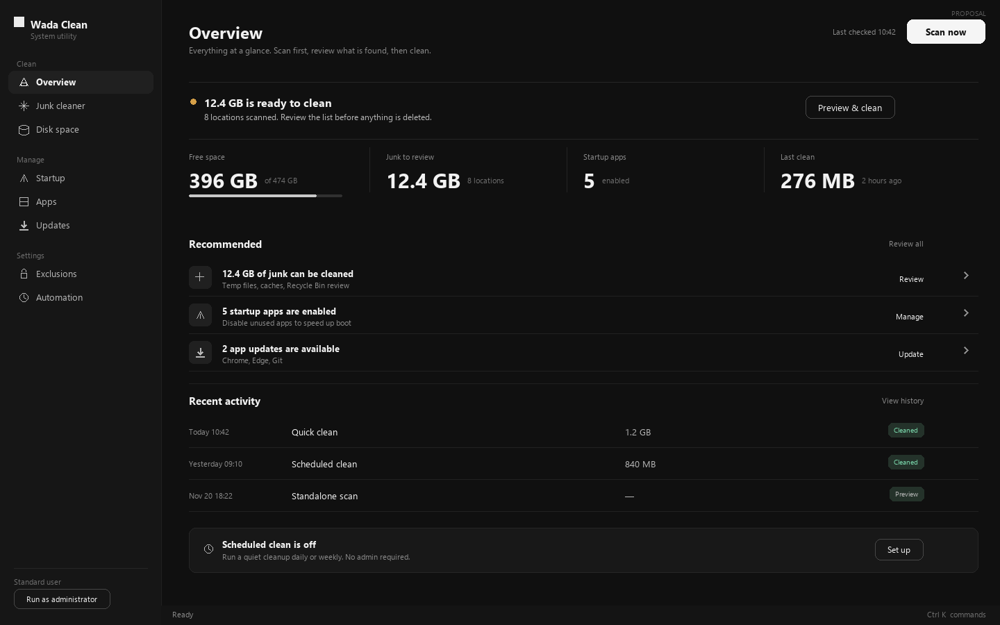
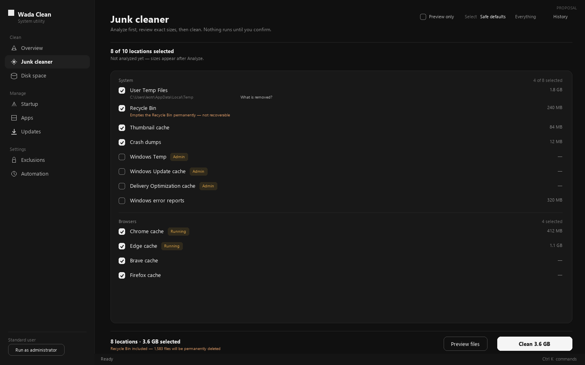

> **Superseded (v0.2).** This review covers v0.1.0 and the nine-screen app it
> shipped with. v0.2 "One Door" removed most of those screens; the current
> direction, screen map and decision log are in
> [../PLAN-ONE-DOOR.md](../PLAN-ONE-DOOR.md). The v0.1 findings below remain as
> evidence for why the cut happened — several file links point at deleted code.
# Wada Clean — UI/UX review, benchmark, and improvement plan

> Review of `wada-clean` v0.1.0 (commit `72ca3ea`), based on the built `wada_clean.exe` and a
> read of the UI/engine/platform sources. Screens were captured with CUI's own
> `CUI_SCREENSHOT` path, so they are real renders, not mockups. Environment: 1920×1080
> display at 125% scaling, English and Tiếng Việt, plus a 1120×740 localization pass.
>
> **Status:** §3–§4 describe the state at review time. §11 records the first implementation
> pass that followed this review and says what is still open; the "before" images remain as
> evidence.

| Contents | |
|---|---|
| 1 | [TL;DR — six moves](#1-tldr--six-moves) |
| 2 | [What already works](#2-what-already-works) |
| 3 | [Findings](#3-findings) |
| 4 | [Screen-by-screen notes](#4-screen-by-screen-notes) |
| 5 | [Benchmark: open-source cleaners](#5-benchmark-open-source-cleaners) |
| 6 | [Proposed direction: "quiet utility"](#6-proposed-direction-quiet-utility) |
| 7 | [Feature / function roadmap](#7-feature--function-roadmap) |
| 8 | [What to remove](#8-what-to-remove) |
| 9 | [Measuring improvement without telemetry](#9-measuring-improvement-without-telemetry) |
| 10 | [Open decisions](#10-open-decisions) |
| 11 | [Implementation status](#11-implementation-status) |

---

## 1. TL;DR — six moves

The visual language is already calm and distinctive. The problems are **state honesty,
duplication, and missing trust features**, not taste. Six changes buy the most:

1. **Stop claiming health before the scan.** The Overview says *"System Ready"* while
   the same screen says *"Reclaimable Junk: Not scanned"*. Three states — *Not checked*,
   *Checking*, *Result* — and never a green "ready" before data exists.
2. **Make irreversible actions carry their own warning.** The Recycle Bin is selected by
   default and is emptied permanently, but today it is just one row among ten in a
   two-click confirmation. Name the consequence, show the file count, and reconsider
   default-on.
3. **Remove one of every duplicate.** Two admin CTAs, two "Select all" mechanisms, four
   `0 B` metrics, three places to "Refresh", one status bar used for metadata instead of
   the status. Each duplicate costs attention and makes the app feel busier than it is.
4. **Group the navigation by job** — *Clean · Manage · Settings* — and drop the single
   "Tools" label. Same eight destinations, far easier to scan.
5. **Give the user one new trust feature before any new tool: a per-file preview.**
   "Analyze → Preview → Clean" is this app's promise, but *Preview* currently means a
   byte total, not files. A read-only file list is the single highest-value addition and
   matches BleachBit's preview and Mole's `--dry-run`.
6. **Fix the feedback loop.** Validation and failures are only reported in the tiny
   bottom-left status bar, which normally displays product/theme/version metadata.
   Put errors next to the field, confirmations next to the button, and reserve the status
   bar for persistent context.

A concrete proposal of the two most important screens is at
[proposal-overview.png](images/proposal-overview.png) and
[proposal-cleaner.png](images/proposal-cleaner.png). The rest of this document explains
why, with file-level evidence and a prioritized backlog.

---

## 2. What already works

Worth protecting, and worth saying out loud in the README:

- **The safety model is better than most of the category.** Analyze is a distinct job,
  `has_analyzed` gates cleaning, and destructive runs need a second click. Compare
  Stacer, which cleans without confirmation, or Optimizer, which applies toggles
  immediately. The engine also refuses to follow reparse points and honours exclusions
  in both the interactive and the scheduled path.
- **Read-only analysis is truly read-only.** The disk view never deletes; cleanup is a
  separate destination. That separation is exactly what WinDirStat/WizTree users rely on.
- **Startup toggling is reversible** through `StartupApproved`, rather than deleting
  entries — a meaningful trust advantage.
- **The visual language is restrained and coherent.** Monochrome surfaces, one white
  primary button, 24px display numbers, 8px radii. It already looks more "quiet utility"
  than CCleaner-style marketing UI, and the Vietnamese strings hold at 1120px
  ([evidence](images/current-cleaner-vi-1120.png)).
- **Native footprint, no telemetry, no upsells.** That is the product's differentiator;
  every recommendation below should preserve it.

---

## 3. Findings

Severity: **P0** = breaks trust or blocks a task · **P1** = friction/confusion worth
fixing this cycle · **P2** = polish. Effort: S ≤ ½ day · M 1–2 days · L 3–5 days · XL > 1 week.

| # | Sev | Screens | Finding | Why it matters | Fix | Effort |
|---|---|---|---|---|---|---|
| F1 | P0 | Overview | "System Ready" hero is shown before any scan, next to "Not scanned" ([health:68‑83](../../src/ui/wc_view_health.c#L68)) | Contradicts the screen and undermines every other status | Derive the hero from a 3-state scan status; "Not checked yet" + primary "Scan now" | S |
| F2 | P0 | Cleaner | Recycle Bin is default-selected and permanently emptied; the only signal is a normal checkbox row ([rules:23](../../src/engine/wc_rules.c#L23), [worker:92‑120](../../src/engine/wc_worker.c#L92)) | Users think "cleaner = junk"; this deletes user files. Irreversible. | Default off, or a separate "User data" group with explicit "Empties Recycle Bin (N files)" + count preview | S |
| F3 | P0 | Startup | Admin rows render a grey, off-looking switch while the label reads "Enabled" ([startup:117‑127](../../src/ui/wc_view_startup.c#L117)) | Users cannot tell whether the item is on, off, or broken | Replace the control with a lock icon + "Requires administrator" and an inline elevate action | S |
| F4 | P0 | All | Errors and validation live only in the shell status bar; the bar otherwise shows product/theme/version ([app.c:438‑443](../../vendor/wada-c/src/shell/wada_app.c#L438)) | Feedback is far from the action, easy to miss, and overwritten | Inline field errors; confirmations next to the button; status bar = persistent facts | M |
| F5 | P1 | Cleaner, Apps | Confirmation copy points at the old label: "Click Clean Selected again" while the button already says "Confirm Clean" ([cleaner:326](../../src/ui/wc_view_cleaner.c#L326), [apps:196](../../src/ui/wc_view_apps.c#L196)) | Small, but it is the moment the user must trust you | Make the message name the current button verb | S |
| F6 | P1 | Nav | Eight destinations under one "Tools" label ([product:414‑454](../../src/ui/wc_product.c#L414)) | No job grouping; settings look like tools; scan time grows | Group: Clean / Manage / Settings (see §6) | S |
| F7 | P1 | Cleaner, Overview | Duplicated selection controls (global + per category), duplicate admin CTA (sidebar + recommendations) ([product:458‑465](../../src/ui/wc_product.c#L458), [health:216‑222](../../src/ui/wc_view_health.c#L216)) | Two controls doing the same thing suggest they do different things | Keep one of each; per-category selection is the better one | S |
| F8 | P1 | Cleaner | Before Analyze the summary shows four `0 B`/`0` metrics ([cleaner:353‑362](../../src/ui/wc_view_cleaner.c#L353)) | Looks like a completed result of "nothing found" | Show "—" or an explicit *Not analyzed* state until data exists | S |
| F9 | P1 | Cleaner | Summary mixes current selection, all-target totals, last run, and skip counts in one 2×2 grid (same lines) | Numbers that look comparable are not comparable | Split "This run" vs "All targets", or remove the grid (see proposal) | M |
| F10 | P1 | Exclusions | Requires typing an absolute path; no Browse picker, no drag-and-drop, validation only after submit ([exclusions:124‑131](../../src/ui/wc_view_exclusions.c#L124)) | Hostile to normal users; the best way to add an exclusion is *from a scan result* | Browse… button, drop target, inline validation, "Exclude" action on preview rows | M |
| F11 | P1 | Updater | Empty screen puts the CTA top-left, instructions center, and shows winget availability only after a check (and only when it is missing) ([updater:32‑40](../../src/ui/wc_view_updater.c#L32)) | Vast empty space, unclear next step, avoidable dead end | One centered empty state with the primary action; probe winget at open | S |
| F12 | P1 | Automation | Tray mode is session-only, hidden on leave, and `--scheduled-clean` never notifies ([schedule:87‑101](../../src/ui/wc_view_schedule.c#L87), [main:61‑177](../../src/main.c#L61)) | The advertised "scheduled clean + tray notification" experience does not exist | Implement a real background/tray mode or relabel the feature honestly | L |
| F13 | P1 | Exclusions | Cookie prune runs synchronously in the frame, deletes with one click, and only touches Chromium `Default` profiles ([exclusions:58‑118](../../src/ui/wc_view_exclusions.c#L58)) | UI freeze; irreversible logout; missing Firefox/other profiles despite engine support | Worker + confirmation + all Chromium profiles + Firefox; report per browser | M |
| F14 | P1 | Overview, Startup, Apps | Registry/DB lists are enumerated synchronously on first paint ([health:12](../../src/ui/wc_view_health.c#L12), [startup:48](../../src/ui/wc_view_startup.c#L48), [apps:80](../../src/ui/wc_view_apps.c#L80)) | Jank on machines with many apps/startup entries; violates the project's own non-blocking rule | Move to existing worker pattern; show skeleton rows | M |
| F15 | P1 | Cleaner, History | History stores only a summary string and totals; no per-target detail, no restore ([history.h](../../src/engine/wc_history.h), [cleaner:414‑441](../../src/ui/wc_view_cleaner.c#L414)) | The worst failure class — "it deleted something I needed" — is unrecoverable | Detail view + quarantine/restore (see §7) | L |
| F16 | P2 | Shell | Status bar exposes "dark" and "0.1.0" (shell-level, not product-level) | Feels like a developer build | Move version/theme to About; status bar shows last scan / path / counts | S |
| F17 | P2 | All | 11px metadata and muted paths are below a comfortable floor; several secondary labels are low-contrast | Readability, especially at 100% DPI | 12px minimum caption, 13px body, raise muted contrast | S |
| F18 | P2 | Apps, Updater | Sort has no direction indicator; refresh is inconsistent across screens; update count copy is not plural-aware | Small friction and a localization smell | Arrow / "Size ↓", one Refresh pattern per screen, plural forms | S |
| F19 | P2 | All | No About/Settings screen; theme (Ctrl+T) and palette (Ctrl+K) are undiscoverable | Power features invisible | Add "About & shortcuts" in Settings; show Ctrl+K in the status bar | S |
| F20 | P2 | Startup, Cleaner | One bordered card per row creates heavy visual vibration at 10+ rows | The content should lead, not the boxes | One surface with dividers plus hover/selected rows | M |
| F21 | P2 | Cleaner, History | History summaries are stored in English and rendered verbatim in the Vietnamese UI ([product:199](../../src/ui/wc_product.c#L199), [main:169](../../src/main.c#L169)) | Mixed-language UI; breaks localization | Store structured fields, format at render time | S |
| F22 | P2 | Apps | Uninstall launches the vendor uninstaller but does not refresh the list; no install location/reveal | User is left guessing whether it worked | Refresh after launch + "Open install location"; show progress state | S |

### The four P0s in detail

**F1 — honest health.** The hero logic is `running ? "Analyzing" : has_analyzed ? … :
"System Ready"`, so the pre-scan state is green by default. This is not just copy: it
teaches users to ignore the badge. Fix by making scan status a first-class state
(`unscanned | scanning | fresh | stale`) and writing the hero from it. "Not checked yet"
with a white "Scan now" is calmer *and* more accurate than a green reassurance.

**F2 — the Recycle Bin decision.** Emptying the Recycle Bin is a legitimate cleaner
feature (CCleaner, BleachBit and PC Manager all offer it), but it is not junk: it is the
user's last line of recovery. Today it is on by default, its row looks identical to the
thumbnail cache, and the confirm dialog is shared with everything else. Minimum change:
a dedicated "User data" group, default **off**, with the file count and "permanently
deletes" language. Better: route it through the same preview/quarantine flow as other
targets.

**F3 — disabled ≠ off.** `cui_switch(..., .disabled = locked)` keeps the switch
off-looking while the text says "Enabled". Non-admin users on HKLM entries will genuinely
believe the item is disabled. Replace with a static lock + "Requires administrator" and
an action that re-launches elevated (the app already supports relaunch). Reserve switches
for things the current user can actually change.

**F4 — feedback placement.** The status bar is 24px of shell chrome at the bottom left,
and it is also the app's "toast" mechanism for success, validation, and failure. At 1920
it is tiny; at 1120 it is still tiny. Move validation inline, move the result after a
clean to a visible callout or the action bar, and let the status bar show persistent
facts (last scan, selected bytes, current folder). This is the change users will feel
most often.

---

## 4. Screen-by-screen notes

### Overview (Health)


- **Keep:** one primary action, the big storage number with a used bar, last-clean date,
  quick links. The two-column KPI grid is calm.
- **Fix:** F1, F7, F8/F9 (only on Cleaner), F16. "Startup Programs 5 enabled / 5 total"
  and "Last Clean 276 MB" are good facts but sit in equal-weight boxes; make storage the
  hero and the rest a single band (see proposal).
- **Remove:** the duplicate "Restart as Administrator" button in Recommendations; the
  sidebar already has one. Also drop the "Everything looks good!" sentence when the
  screen already says System Ready.
- **Add later:** last scan time, scheduled-clean status, app updates as a recommendation.

### Junk Cleaner


- **Keep:** the Analyze → (confirm) Clean flow, the current-target progress, per-target
  badges (`Admin`, `Running`, `Cleaned`), and the browser-running warning.
- **Fix:** F5, F7, F8, F9, F20, F21.
- **The right Summary panel is the main casualty of minimalism.** Four values, two
  progress bars, and a history list compete with the list the user must act on. Move the
  selection total and action into a sticky bar under the list; keep history behind a
  "History" link. The proposal does this and adds the frictionless path
  "Preview files → Clean" in one bar.
- **Recycle Bin** needs its own treatment (F2), and the dry-run switch should read
  **"Preview only"** and sit next to the action, not float in the top-right corner.
- **Coverage note:** paths are truncated only by `nowrap`; at narrow widths they clip
  without ellipsis. Prefer middle-ellipsis with a tooltip, or show paths only on an
  expanded row.

### Startup


- **Keep:** search + count, reversible toggles, source badges, command line as evidence.
- **Fix:** F3 first; then group by scope (User / System), add an enabled/disabled filter,
  and replace the toggle label with a state column. Do **not** invent an "impact" score:
  honest categories beat a fake number (Task Manager's impact is derived from boot
  telemetry we do not have).
- **Small:** "Refresh" is the only header action; a count and filter should sit beside
  search, not at the far right of the header.

### Installed Apps


- **Keep:** dense list, name/size sort, detail panel, two-click uninstall.
- **Fix:** F18, F22; show install date only if it exists (currently a lone "—"); make the
  size column tabular and align right; add "Open install location" and refresh after
  uninstall. The detail card is tall and empty at the bottom — a compact definition list
  with the action at the bottom is fine, but the `cui_box` filler leaves a hole; consider
  a footer row inside the card instead.

### Disk space


- **Keep:** read-only promise, path bar, quick presets, KPI band, Largest Folders/Files.
- **Fix:** F4 (invalid path feedback), F10-adjacent (Browse… picker), add drill-down
  (click a folder to scan it) and an "Exclude from cleaning" action on folders.
- **Add later:** "by type" (video/archives/installers) and "older than 1 year" filters —
  the two questions people actually ask after seeing a large folder. No treemap; it would
  be a new visual language for marginal value in a CUI app.
- **Remove:** the permanent `0 B / 0 / 0` KPI row before the first scan (same F8 issue).

### Software Updater


- **Keep:** winget-only scope (no fake catalog), per-item update, update-all, count.
- **Fix:** F11 first. Show winget availability as a status line at open ("winget 1.8 ·
  ready"), remember last check time, and make the empty state the action
  ("Check for updates" centered with one sentence). Add per-app "Ignore this version" and
  explain that some installers may prompt for admin.
- **Note:** this screen is the emptiest in the app. In a minimalist product, an empty
  screen is a chance to teach the workflow, not a dead end.

### Exclusions


- **Keep:** two tabs, count, simple list, inline empty state.
- **Fix:** F10, F13. The killer workflow is "I saw a folder in Disk Analyzer / Cleaner →
  Exclude it". Build that before building a path parser. The cookie tab should state
  which browsers and profiles are covered, show per-browser counts after a preview, and
  require confirmation before deleting.
- **Small:** Cookie allowlist has no explanation of *what* is kept (cookies for listed
  domains) versus removed (everything else); one sentence would prevent surprises.

### Automation


- **Keep:** Off/Daily/Weekly segmented control, hour stepper, next-run line, tray test.
- **Fix:** F12, plus: minutes and weekday, "Run now", last result, and a note that the
  task runs without admin. The "Refresh" inside the card and the "Save" button are a
  two-button pattern where one would do (save + auto-refresh).
- **Copy:** "Runs safe non-admin temp cleanups silently" is accurate but vague — name the
  scope ("Temp files, caches, Recycle Bin is never touched") so the choice is informed.

---

## 5. Benchmark: open-source cleaners

I compared the flows of [BleachBit](https://github.com/bleachbit/bleachbit),
[Stacer](https://github.com/oguzhaninan/Stacer),
[Optimizer](https://github.com/hellzerg/optimizer),
[Microsoft PC Manager](https://pcmanager.microsoft.com/en-us) (freeware),
[WinUtil](https://github.com/ChrisTitusTech/winutil),
[Mole](https://github.com/tw93/Mole) (TUI, GPL-3),
[WizTree](https://diskanalyzer.com/) / [WinDirStat](https://windirstat.net/),
[Filelight](https://apps.kde.org/filelight/), and
[CleanMyMac](https://macpaw.com/cleanmymac) as a commercial pattern reference.
Apple's sidebar guidance and Microsoft's WinUI layout/type guidance were used for the
structural recommendations.

### Where Wada Clean stands

● yes · ◐ partial · ○ no

| Capability | BleachBit | Stacer | Optimizer | PC Manager | Mole | WizTree | **Wada** |
|---|---|---|---|---|---|---|---|
| Per-item file preview | ● | ● | ◐ | ○ | ● | ○ | ○ |
| Dry-run / preview mode | ● | ○ | ◐ | ○ | ● | ○ | ● |
| Exclusions honored in engine | ● | ◐ | ○ | ○ | ● | ◐ | ● |
| History detail / undo | ◐ | ○ | ◐ | ◐ | ● | ○ | ◐ |
| Scheduled clean | ◐ | ○ | ◐ | ◐ | ○ | ○ | ◐ |
| Startup manager | ○ | ● | ● | ◐ | ○ | ○ | ● |
| Uninstaller | ○ | ● | ● | ○ | ● | ○ | ● |
| Disk analysis | ○ | ○ | ○ | ◐ | ● | ● | ● |
| App updater | ◐ | ○ | ◐ | ○ | ● | ○ | ● |
| Tray / background | ○ | ○ | ○ | ● | ○ | ○ | ◐ |
| CLI parity (JSON/exit codes) | ◐ | ○ | ● | ○ | ● | ○ | ○ |
| i18n | ● | ◐ | ● | ● | ● | ● | ● |

Wada is already **above the OSS median** on feature breadth. Its deficits are in the
trust layer (preview, undo) and in follow-through on advertised background behavior —
not in the number of tools.

### Eight patterns worth copying

1. **Preview as a separate verb** (BleachBit `--preview`, Mole `--dry-run`): a read-only
   list of files with sizes, cancelable, exits cleanly. Make this a first-class action in
   the Cleaner and on the CLI.
2. **Return results deselected; offer a header bulk-select** (Stacer). Wada starts with
   safe defaults selected — good — but the per-item control should be the default mental
   model once results exist.
3. **Risk tiering you can unlock** (BleachBit Expert Mode): protected options are visible
   but locked with an explanation, not silently missing. Maps to "Admin" and "Recycle
   Bin" here.
4. **Fail closed** (Mole): when whitelist/config cannot be read, refuse to run rather
   than running without protection. Wada's scheduled path honors exclusions only if the
   DB opens; today it silently proceeds if the exclusions list fails. Make it refuse and
   log.
5. **One front door, then drill down** (PC Manager health checkup, CleanMyMac Smart
   Care): answer "is my PC OK?" on Overview, then route. Wada's Overview has the right
   instinct; it needs honest state and fewer competing widgets.
6. **Analysis mode never deletes** (WizTree, WinDirStat): keep Disk Space as its own
   read-only mode; never add a "clean from here" bulk button.
7. **Per-action revert stated at the action** (WinUtil): "reversible" belongs on the
   button/tooltip, not only in docs.
8. **A history/log users can paste into an issue** (Mole `history`, BleachBit logs): Wada
   already stores summaries; expose them (targets, skips, paths, errors) with copy/export.

### Five failure modes to design against

1. **Silent success/failure** — Stacer accepts a wrong sudo password and every action
   fails invisibly. Lesson: one result line per target — *cleaned / skipped (why) /
   failed (error)* — visible on screen, not only in a log.
2. **Unrecoverable purge** — an Optimizer issue reports desktop files deleted with no
   recovery. Lesson: quarantine beats permanent delete for a v1 cleanliness app.
3. **Unattributable change** — users cannot tell which toggle caused a regression.
   Lesson: per-action journal entries with time, target, before/after, and inverse.
4. **Hidden side effects / no restart notice** — cached logins or shell state change
   without warning. Lesson: every rule declares side effects in plain language.
5. **Mislabeled affordances** — "Get installed" read as an active verb. Lesson:
   verb-object labels that preview the consequence ("Clean 3.6 GB", "Empty Recycle Bin").

Sources: BleachBit issue [organization/UX](https://github.com/bleachbit/bleachbit/issues),
[Stacer](https://github.com/oguzhaninan/Stacer/issues),
[Optimizer](https://github.com/hellzerg/optimizer/issues),
[Mole README](https://github.com/tw93/Mole), [WinUtil docs](https://winutil.christitus.com/),
[Nielsen Norman: confirmation dialogs](https://www.nngroup.com/articles/confirmation-dialog/),
[empty states](https://www.nngroup.com/articles/empty-state-interface-design/),
[progress indicators](https://www.nngroup.com/articles/progress-indicators/).

---

## 6. Proposed direction: "quiet utility"

### Six principles

1. **One question per screen.** Overview answers "is anything wrong?"; Cleaner answers
   "what will be removed?"; Disk answers "what is using space?". Settings never mixes
   with tools.
2. **One primary action per screen.** Everything else is secondary or a text action. On
   Cleaner, the primary action is the *clean/review* button, not "Analyze" forever.
3. **Numbers lead, chrome recedes.** Fewer cards, more dividers; the 24px number and the
   row name are the hierarchy.
4. **Never infer state.** If it was not measured, say "not checked". If it is unknown,
   say "—". If it is irreversible, say so.
5. **Show the consequence.** Button labels include the object and the size; confirmation
   names the same verb; the Recycle Bin says "permanently".
6. **Reversible by default, destructive by exception.** Quarantine for clean actions,
   `StartupApproved` for startup, read-only for analysis. The Recycle Bin is the exception
   that must be opt-in.

### Information architecture (near-term, low risk)

Group the existing eight destinations instead of adding/removing tools:

```text
Clean      Overview · Junk cleaner · Disk space
Manage     Startup · Apps · Updates
Settings   Exclusions · Automation
```

`Ctrl+1…8` follow the visual order (Health, Cleaner, Disk, Startup, Apps, Updater,
Exclusions, Automation); `Ctrl+K` remains the discoverable path to every command. This was
remapped once, before 1.0, in the first implementation pass (§11).

A later, more aggressive consolidation (only if you want it) is five destinations:
`Overview · Clean · Manage · Space · Settings`, with Startup/Apps/Updates as tabs of
Manage and Exclusions/Automation as tabs of Settings. That removes 3 items from the rail
without losing a feature, but it is a 3–5 day refactor and should be a deliberate release
theme, not a quick change.

### Visual system tweaks

Keep the current dark palette; it already works. Tighten it:

| Role | Current | Recommendation |
|---|---|---|
| Canvas / card | `#121212` / `#181818` | Keep; add one muted surface `#202020` for inputs/selected rows |
| Border | `#2b2b2b` | Keep for structural dividers; do not outline every row |
| Primary button | White fill, dark text | Keep — distinctive, accessible, cheap |
| Success | mint `#7cdcaf` | Keep; text/icon only, never a large fill |
| Warning / admin | amber | Keep; pair with a label, not colour alone |
| Caption | 11px | 12px minimum; body 13px, page title 24px, section 15px |
| Spacing | mixed | 4/8/12/16/24/32 only; card padding 16, section gap 24 |
| Radius | 8–12 | Keep 8 for controls, 10–12 for surfaces |

Density: prefer **compact rows** (40–44px) inside one surface over many small cards.
Cards are justified for a *group* of things or a metric band — not for a single toggle
(the sidebar footer currently wraps a button and a badge in no surface at all; that is
fine).

### Proposed screens



What changed on Overview:

- One honest status line; one primary "Scan now"; the scan result is a sentence, not a
  badge that can lie.
- A single KPI band (storage, junk, startup, last clean) with dividers instead of four
  boxes; storage keeps the bar.
- "Recommended" is a list of *consequences with actions*, not a card of alerts and three
  buttons. One row per thing to do.
- Recent activity is compact and has a status; the scheduled-clean state is a strip with
  a single "Set up" action.
- The sidebar is grouped; the duplicate admin CTA is gone (one footer action); the status
  bar shows "Ready" / "Ctrl K commands", not the theme and version.



What changed on Cleaner:

- One full-width list, one surface, dividers. Paths and "What is removed?" live on the
  expanded row; the folder icon is not repeated on every row.
- Sticky action bar: selection summary, warning for irreversible targets, "Preview
  files", and the single primary "Clean 3.6 GB". The 2×2 Summary card and history rail
  are gone (history is a header action).
- Recycle Bin is a distinct row with permanent-deletion language; admin-only targets
  carry a badge and are not presented as toggleable.
- "Preview only" is a labelled checkbox next to "Select: Safe defaults / Everything";
  the dry-run state is not a floating switch.

The mockups are intentionally close to the existing visual language. They are a
direction, not a pixel spec: CUI's components already support everything shown except
the sticky action bar (implement with a fixed-height row + scroll area).

---

## 7. Feature / function roadmap

Prioritized for a minimalist app: trust first, then coverage, then convenience.

### Now — trust and clarity (≈1 week)

| Item | Detail | Acceptance |
|---|---|---|
| Honest scan states | `unscanned → scanning → result`; Overview hero and Cleaner headline use it | No green "ready/healthy" anywhere before data exists |
| Recycle Bin decision | Default off or separate group + explicit warning + count | A user can explain what will be permanently deleted before confirming |
| Startup admin rows | Lock + "Requires administrator" + elevate action | No disabled-looking switch next to "Enabled" |
| Remove duplicates | One admin CTA, one select-all mechanism, no `0 B` placeholders, one Refresh placement | Each action appears once per screen |
| Copy pass | "Click Confirm Clean", "Confirm uninstall", "Preview only" | Confirmation message names the visible button |
| Inline feedback | Field errors under the input; results in the action area | Failure is visible within 200 ms without leaving the control |
| Nav grouping | Clean / Manage / Settings | 3 group labels, 8 items, identical shortcuts |
| Browse… picker | Exclusions and Disk paths | Add a folder without typing a path |
| Typography floor | 12px captions, 13px body | No body copy below 12px; VI still fits at 1120 |

### Next — the trust layer (2–4 weeks)

| Item | Detail | Why |
|---|---|---|
| Per-file preview | Read-only list (top 500 + total), filter, sizes, "Exclude this" | The missing half of Analyze → Preview → Clean; parity with BleachBit/Mole |
| Quarantine + restore | Move deleted files to `%LOCALAPPDATA%\Wada Clean\quarantine` with a manifest; restore from History | Turns the worst failure into an undoable event |
| History detail | Per-target rows with cleaned/skipped reasons; export/copy | Makes support and trust possible |
| Cookie cleanup hardening | Worker, confirmation, all Chromium profiles, Firefox, per-browser report | Current one-click/one-profile behavior is the riskiest UI in the app |
| Async lists | Startup/apps/exclusions enumeration on workers + skeleton rows | Removes first-open jank |
| Schedule robustness | Minute + weekday, last result, "Run now", missed-run catch-up, battery guard | Makes automation dependable |
| Tray truth | Either a real background mode (persisted, notifies scheduled results) or remove the claim | Advertised behavior must exist |
| Window fit | Clamp restored/default size to the monitor work area | Default 1120×740 exceeds a 1366×768 screen's usable height |

### Later — coverage and ecosystem (post-v1)

- **Cleaner coverage:** Windows error reports, Delivery Optimization cache; optional
  browser session/history targets. Add a few high-value rules, not a rule marketplace.
- **Picker coverage:** Chromium *all profiles*, Firefox cookies, per-profile cache paths.
- **Startup:** scope grouping, enabled/disabled filter, open file location. Only add an
  impact score if measured, never estimated.
- **Apps:** install location, refresh after uninstall, later a leftover scan with clear
  risk labeling.
- **Disk:** drill-down, file-type and age filters, "exclude folder".
- **Updater:** last checked, per-app ignore, admin note.
- **CLI parity:** `--json`, `--version`, `--help`, `--restore`, stable exit codes; make
  the headless path scriptable like Mole.
- **Rule packs** (optional): a user-editable rule file, fail-closed like Mole; not a
  server catalog.
- **Restore point** before system-scope writes (optional, Windows-only; slow, so opt-in).

---

## 8. What to remove

- Duplicate admin CTA on Overview.
- Duplicate global Select all/Clear on Cleaner (keep category-level).
- Four `0 B` metrics and the separate Summary card (fold into the action bar).
- Status-bar theme/version (move to About).
- One of the three "Refresh" placements; pick header-right everywhere.
- "Enabled"/"Disabled" text next to working switches (keep only for locked rows).
- Folder icons repeated on every cleaner row (show on expanded row/hover).
- Claims that are not implemented (tray notifications for scheduled cleans) — remove the
  claim until the behavior exists.
- Any temptation to add: registry cleaner, driver updater, RAM booster, treemap,
  "1-click clean everything" that skips review. They are the opposite of the product's
  stated values.

Keep: Analyze → Preview → Clean, two-click confirmation for irreversible actions,
read-only disk analysis, exclusions, VI localization, zero telemetry, no upsells, native
binary.

---

## 9. Measuring improvement without telemetry

No analytics is the right call. Validate with:

1. **Five short usability sessions** (not users of the app; Windows users who clean
   occasionally). Tasks: "free at least 1 GB safely", "stop this app from starting at
   boot", "make sure this folder is never touched". Measure: time to first correct
   action, wrong clicks, confidence (1–5), and whether they can explain what the
   confirmation will do.
2. **A ten-point heuristic checklist** run every release: one primary action, no
   duplicate control, honest empty/loading/error states, feedback next to the action,
   destructive action named + sized, reversible where possible, keyboard reachable,
   EN/VI at 1120 and 1920, 100/125/150% DPI, no clipped content.
3. **Golden-screen regression** using CUI's built-in capture. The app already supports
   `CUI_SCREENSHOT=<path>` and `CUI_SCREENSHOT_FRAMES=<n>`; a small script can drive
   `Ctrl+1…8` and diff the renders per language/width. This review's images were produced
   that way.
4. **Issue taxonomy:** label bug reports `ux/confusion`, `ux/trust`, `ux/polish` and track
   which screens generate them; that is your real UX metric.

---

## 10. Open decisions

Resolved in the second pass: the Recycle Bin is now off by default; cookie cleanup covers
every Chromium profile and Firefox on a background worker with confirmation; the tray claim
matches the behavior (in-app only); `Ctrl+K` is advertised in the sidebar.

Still open:

1. **Quarantine:** adopt it for all clean actions (changes engine, storage, history) or
   only for the risky targets? I recommend all file deletes in v1, with a 7-day retention.
2. **IA:** keep grouped 8 destinations, or consolidate to 5 with tabs? The first is a
   one-day change; the second is a release theme.
3. **Real background/tray mode:** the copy is honest now, but the icon still disappears when
   the window closes. Implement a real background mode (needs shell support) or leave it as
   an in-app convenience?
4. **Windows-only v1:** several strings say "Windows", the macOS backend exists, and CI
   dropped macOS. Either commit to Windows-first copy or restore the macOS lane.

---

## 11. Implementation status

The follow-up passes shipped after this review. The build is green (all five test suites pass:
180 + 115 + 62 + 68 + 51 checks) and the affected screens were re-captured in English at
1920×990 and, where the change affects layout, in Vietnamese at 1400×925 (1120×740 logical).

| Shipped | Details |
|---|---|
| Grouped navigation | **Cleanup** (Health, Cleaner, Disk) · **Manage** (Startup, Apps, Updater) · **Settings** (Exclusions, Automation); `Ctrl+1…8` follow the visual order |
| Honest Overview | The pre-scan hero is "Not checked yet" (neutral) instead of "System Ready"; the duplicate *Restart as Administrator* button is gone (the sidebar keeps one) |
| Cleaner simplification | Global Select all/Clear removed (category controls remain); "Dry run (preview only)" → "Preview only"; `0 B` metrics replaced with "—" until measured; *Last Freed / Last Skipped* read from history instead of a reset snapshot; Recycle Bin row states "Emptied permanently — this cannot be undone."; confirmation copy now says "Click Confirm Clean" |
| Recycle Bin safety | Off by default (scheduled clean no longer empties it); the warning stays on the row so opting in is an informed choice |
| Cookie cleanup | Background worker over every Chrome/Edge/Brave profile plus Firefox; local "Preview only" default; two-click confirm for clean; determinate progress; per-run report; running browsers are skipped in both modes |
| Per-file preview | Analyze now samples up to 256 real file paths with sizes; a full-width **Preview files** panel groups them by target, names what stays behind when samples are truncated, warns that locked files are skipped, and is reachable from the Cleaner or `Ctrl+P` |
| History detail | New runs persist one `id\|label\|files\|bytes\|skipped\|note` row per target (v2 records; v1 still reads). Recent History rows get **View**; the detail panel shows Freed/Files/Skipped/Targets, per-target rows with skip reasons, and a copy-details button. Reachable with `Ctrl+H`; old entries explain that only totals exist |
| History localization | The detail panel formats its summary and target labels at render time instead of showing the stored English summary, so Vietnamese runs stay in Vietnamese |
| Dry-run honesty | *Last Freed / Last Skipped* and Health's *Last Clean* now use the newest completed clean, not a preview run; previews remain visible in the history list with a **Dry Run** badge |
| About & shortcuts | A sidebar footer link and `Ctrl+/` open a compact modal with version, license, data folder (plus *Open data folder*), and every shortcut (palette, sections, analyze, preview, history, theme, itself) in two keycap columns |
| Discoverability | Sidebar footer advertises `Ctrl K  Commands` and opens **About & shortcuts** (`Ctrl+/`), which lists the palette, section, analyze, preview, history and theme shortcuts; the tray copy and README now say the icon only exists while Wada Clean is open |
| Startup semantics | Admin-only rows show `Enabled/Disabled` + a lock instead of a disabled-looking switch |
| Async lists | Startup and Installed Apps enumerate on a background thread through the reusable `wc_list_job`; the views show a loading state, disable Refresh, and no longer run registry work inside the draw call |
| Updater | The idle state is one centered primary action; the toolbar check button only appears once there is a result to refresh |
| Folder picking | Windows `IFileOpenDialog` picker ("Browse…") in Exclusions and Disk; `wc_plat_pick_folder` added to the platform API |
| Inline validation | Duplicate/invalid exclusion and cookie entries render under the input in danger color instead of only in the status bar |
| Localization fit | Cleaner metrics use a compact byte string ("276 MB" instead of a clipped "276.2 MB") and the Vietnamese *Last Skipped* label was shortened |
| Type floor | 11px captions/metadata raised to 12px across the product UI |

**Findings closed:** F15's detail view is shipped (per-target rows, skip reasons, copy); quarantine/restore remains open. F19 is addressed by the About & shortcuts modal and the footer link. F21 is addressed by render-time formatting of the history summary and target labels.

### Before → after

| Screen | Before | After |
|---|---|---|
| Overview | [before](images/current-overview.png) | [after](images/after-overview.png) |
| Cleaner | [before](images/current-cleaner.png) | [after](images/after-cleaner.png) |
| Startup | [before](images/current-startup.png) | [after](images/after-startup.png) |
| Disk | [before](images/current-disk.png) | [after](images/after-disk.png) |
| Updater | [before](images/current-updater.png) | [after](images/after-updater.png) |
| Apps | [before](images/current-apps.png) | [after](images/after-apps.png) |
| Exclusions | [before](images/current-exclusions.png) | [after](images/after-exclusions.png) |
| Cookie Allowlist | — | [after](images/after-cookie-allowlist.png) |
| Cookie preview report | — | [after](images/after-cookie-report.png) |
| Cookie Allowlist (VI, 1120) | — | [after](images/after-cookie-vi-1120.png) |
| Preview files | — | [after](images/after-preview-files.png) |
| Preview files (VI, 1120) | — | [after](images/after-preview-files-vi-1120.png) |
| History detail | — | [after](images/after-history-detail.png) |
| History detail (VI, 1120) | — | [after](images/after-history-detail-vi-1120.png) |
| About & shortcuts | — | [after](images/after-about.png) |
| About & shortcuts (VI, 1120) | — | [after](images/after-about-vi-1120.png) |
| Automation | [before](images/current-automation.png) | [after](images/after-automation.png) |
| Cleaner (VI, 1120) | [before](images/current-cleaner-vi-1120.png) | [after](images/after-cleaner-vi-1120.png) |
| Updater (VI, 1120) | — | [after](images/after-updater-vi-1120.png) |

### Deliberately not in this pass

- **Quarantine/restore** — deferred; the preview gives informed consent and history now
  explains what each target did, but deletion is still permanent.
- **Real background/tray mode** — the copy is honest now, but the icon still disappears when
  the window closes; a real background mode needs shell support.
- **Status bar** — it still shows theme/version. It is owned by the shell in
  `vendor/wada-c`, so changing it belongs in the framework, not this repo.
- **Browse… on macOS** — the platform stub returns false and the button is hidden; macOS
  keeps the typed-path flow.
- **Per-file sampling on macOS** — the preview API falls back to totals without paths; the
  panel shows its empty explanation rather than pretending to list files.
- **Navigation consolidation** — the eight destinations remain grouped into Cleanup /
  Manage / Settings rather than merged into the review's five-destination proposal; that
  is still an open product decision, not an unfinished layout fix.
- **winget availability** — the probe runs when a check starts, not on app open, so the
  idle Updater view does not spawn a package-manager process.
- **Shortcut compatibility** — `Ctrl+1…8` were remapped to the grouped order; update any
  personal notes or bookmarks. The palette command IDs did not change.- **Destructive cookie run** — the preview path was exercised against a running Edge (the
  browser was skipped correctly) and pruning is covered by the phase4 fixture tests; a
  destructive run against a real signed-in profile was not performed in this pass.
- **Browse… dialog automation** — the native picker compiles, links and is wired, but the
  modal itself was not driven by automation.
